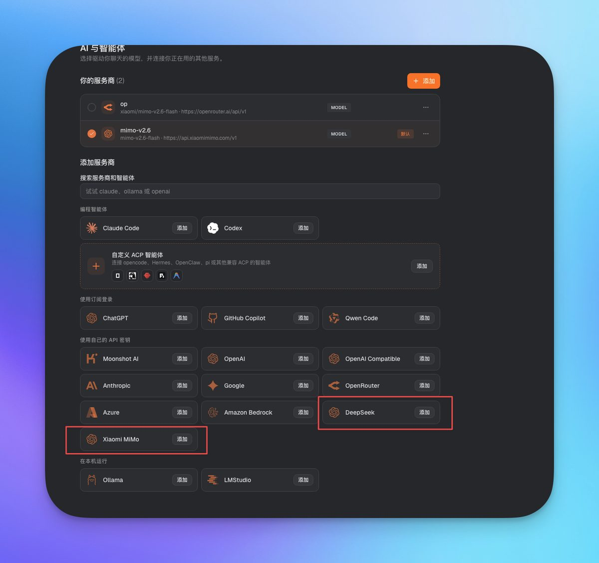
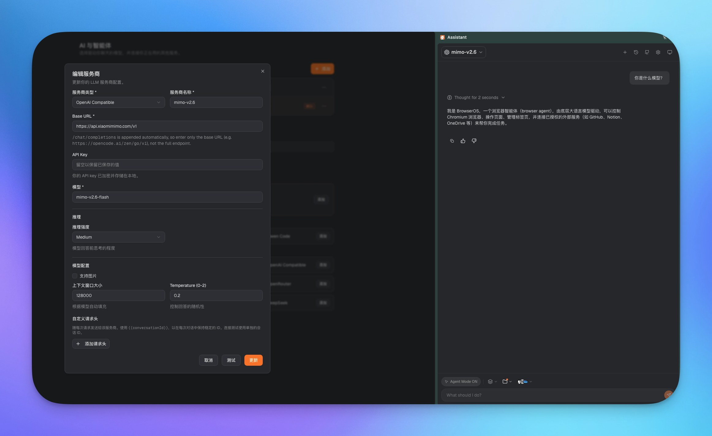

# BrowserOS 中文版（Ask BrowserOS 扩展汉化 + 新增服务商）

基于 [oyangzijian/BrowserOS](https://github.com/oyangzijian/BrowserOS) 的 Ask BrowserOS 扩展，做中文界面汉化，并新增 DeepSeek、Xiaomi MiMo 服务商一键配置。

## 改了什么

- **界面汉化**：设置页、侧边栏、新标签页等 260+ 处英文翻译成中文（键盘键名如 Home/Delete/Tab 故意保留英文）。
- **新增服务商卡片**："使用自己的 API 密钥"从 8 个增加到 10 个，新增：
  - **DeepSeek**：预填 `https://api.deepseek.com`，默认模型 `deepseek-chat`
  - **Xiaomi MiMo**：预填 `https://api.xiaomimimo.com/v1`，默认模型 `mimo-v2.6-flash`
- 两者底层走 OpenAI 兼容协议，保存时自动映射为 `openai-compatible` 类型，服务器稳定识别。





## 文件说明

| 文件 | 说明 |
|---|---|
| `app-DRpXG1p6.js` | 汉化+新增服务商后的主界面文件（对应扩展 `0.0.161.0` 版本 `chunks/` 目录） |
| `background.js` | 汉化后的后台脚本 |
| `tools/zh_map3.json` | 中英对照表 |
| `tools/apply_zh4.js` | 汉化脚本（AST 精确定位替换，`node apply_zh4.js`） |
| `tools/add_providers.js` | 新增服务商脚本（`node add_providers.js`，用 acorn 按模块标准校验） |

## 安装方法（推荐：一键脚本）

1. 从 [Releases](https://github.com/oyangzijian/BrowserOS-zh/releases) 下载 `BrowserOS-zh-v1.0.0.zip` 并解压（不要只解压出单个脚本，整个文件夹都要保留）。
2. 完全退出 BrowserOS（macOS：右键程序坞图标 → 退出；Windows：右键任务栏图标 → 退出）。
3. 双击运行安装脚本：
   - macOS：`installer/install.command`
   - Windows：`installer/install.cmd`

   脚本会自动找到扩展目录、备份原文件（`.bak`），然后替换为中文版。

   > macOS 如果提示"无法验证开发者"：右键点击 `install.command` → 打开 → 仍要打开，即可运行。这是未签名脚本的正常提示，只需操作一次。

4. 重新打开 BrowserOS，打开扩展设置页，界面应为中文。

恢复英文原版：双击运行 `installer/restore.command`（macOS）或 `installer/restore.cmd`（Windows）。

### 手动安装（备用）

如果一键脚本在你的机器上找不到扩展目录，再按以下步骤手动操作：

1. 完全退出 BrowserOS。
2. 找到扩展目录，例如 macOS：
   ```
   ~/Library/Application Support/BrowserOS/Default/Extensions/bflpfmnmnokmjhmgnolecpppdbdophmk/0.0.161.0_0/
   ```
   （`0.0.161.0_0` 是版本号，你的机器上可能不同，取最新的那个）
3. 先备份原文件（重要）：把 `chunks/` 目录下 `app-` 开头的 `.js` 文件复制一份改名为 `.bak` 后缀；把扩展根目录的 `background.js` 复制一份改名为 `background.js.bak`。
4. 用本仓库的 `app-DRpXG1p6.js` 替换 `chunks/` 下的 `app-*.js`，用 `background.js` 替换扩展根目录的同名文件。
5. 重新打开 BrowserOS。

> 注意：扩展带非官方自动更新，更新后会被覆盖，需要重新打补丁（用 `tools/` 里的脚本对新版本重跑即可）。

## 版本

- 基于扩展 `0.0.161.0`，2026-10-10 制作。
- MiMo 模型请用 `mimo-v2.6-flash`（已测试可用）。

## 声明

本仓库文件由 BrowserOS 非官方扩展二次修改而来，仅做界面汉化与服务商配置增强，原版权归原作者所有。
